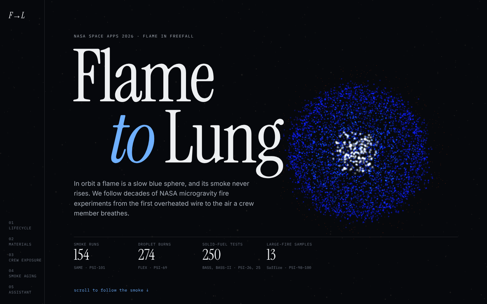
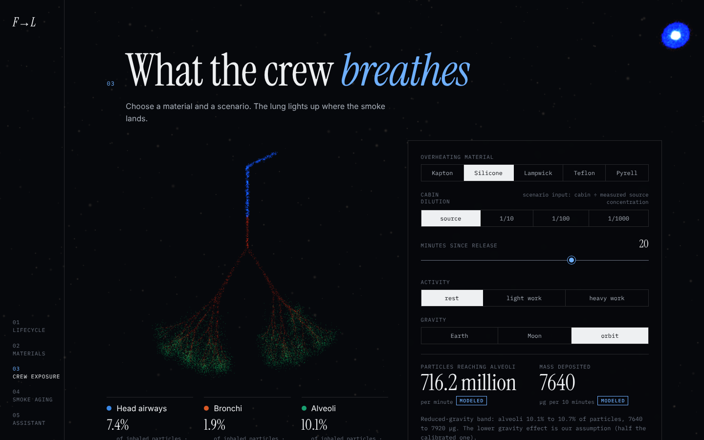

# Flame to Lung

NASA Space Apps Challenge 2026 · **Flame in Freefall**

NASA has run decades of fire experiments in microgravity. Most tools ask *"will it burn?"*.
This one also asks *"what does the smoke do to the crew breathing it?"*

It organizes NASA's experiments along the life of a spacecraft fire (overheating → spread → soot →
extinction → crew exposure), ranks materials by fire evidence and by inhalation hazard, shows where the
two rankings have no data in common, and adds an assistant whose numbers may only come from NASA data
or a cited physics model.

## Run it

    python -m venv .venv
    .venv/bin/pip install -r requirements.txt
    cp .env.example .env          # put your OpenRouter key in LLM_API_KEY
    .venv/bin/python build_data.py        # downloads NASA files, rebuilds the tables
    .venv/bin/python -m pytest -q
    .venv/bin/python -m flask --app server run --host 0.0.0.0 --port 5000

Everything except the Assistant chapter works without a key.

## What is in the repo

| File | What it does |
|---|---|
| `build_data.py` | Downloads NASA PSI files and cleans them into `data/processed/*.csv` |
| `engine.py` | Lung deposition, gravity correction, smoke aging, exposure, hazard matrix |
| `assistant.py` | Four tools + the tool-calling loop for the language model |
| `server.py` | Flask page and JSON API |
| `templates/`, `static/` | The dashboard (Three.js scene, Plotly charts) |
| `data/cards.json` | One summary card per investigation |
| `tests/` | Data, physics and tool checks |

## NASA data used

All from NASA Physical Sciences Informatics (psi.nasa.gov). File hashes are in `data/processed/sources.csv`.

| Study | PSI ID | Rows after cleaning | Used for |
|---|---|---|---|
| SAME / SAME-R | PSI-101 | 154 (124 usable for size) | particle size, count, mass, aging |
| FLEX | PSI-69 | 274 | droplet extinction, cool flames |
| BASS | PSI-26 | 121 | did it burn, by material |
| BASS-II | PSI-25 | 129 (test log) | oxygen and flow conditions |
| Saffire I–III | PSI-98, 99, 100 | 13 samples | large-scale flame spread |

## Models

- **Lung deposition:** ICRP Publication 66 with Hinds' regional equations, integrated over the lognormal
  size distribution NASA measured.
- **Gravity:** the sedimentation share of deep-lung deposition is scaled by gravity. It is calibrated so
  lunar gravity lowers deep-lung deposition by 25% at 0.5 µm and 32% at 1 µm (Darquenne & Prisk 2008).
  Reduced-gravity results are shown as a band; the low end (half the calibrated effect) is our assumption.
- **Smoke aging:** coagulation, `N(t) = N0 / (1 + K·N0·t)`, with K fitted to 43 fresh/aged SAME pairs
  (K ≈ 8.8e-10 cm³/s, leave-one-out count error 17%).
- **Assistant:** an open-weight model with tool calling, reached through OpenRouter. It was not fine-tuned.

## Limitations

| Limit | Why it matters |
|---|---|
| ICRP 66 is a 1g, average-adult model | Individual crew members differ; microgravity values are a band |
| Unit-density spheres assumed | Soot agglomerates are not spheres |
| SAME concentrations are instrument values near the source | Cabin dilution is a scenario input, not a prediction |
| DustTrak mass is calibrated on test dust | Mass doses are approximate |
| Deposition is not toxicity | Chemistry of the particles is not modelled |
| No gas data (CO, HF, HCN) | Gases can dominate real smoke hazard |
| Fitted K includes chamber wall losses | It is an effective coefficient |
| BASS outcomes come from keywords in crew notes | Counts are approximate and flagged in the table |
| BASS-II spread rates are not in the NASA table | No flame-spread model is included |
| Fire and smoke were tested on different materials | Only cotton and silicone have both; the gaps are a finding |

Not built: flame-video computer vision, toxic-gas modelling, LLM fine-tuning, flammability ML.

## References

- ICRP (1994) Publication 66, Human Respiratory Tract Model. Ann. ICRP 24(1–3)
- Hinds, W.C. (1999) *Aerosol Technology*, 2nd ed., Wiley
- Darquenne & Prisk (2008) Eur J Appl Physiol 103:687
- Darquenne et al. (1997) J Appl Physiol 83:2029; Darquenne et al. (2014) J Appl Physiol 117:880
- Link et al. (2018) Sci Rep 8:120
- Urban et al., AIAA 2012; Mulholland et al., Aerosol Sci. Tech. 2015
- Nayagam et al. (2012) Combustion and Flame 159:3583

## Notes

AI tools assisted with writing the code and text in this project. NASA does not endorse this project.
